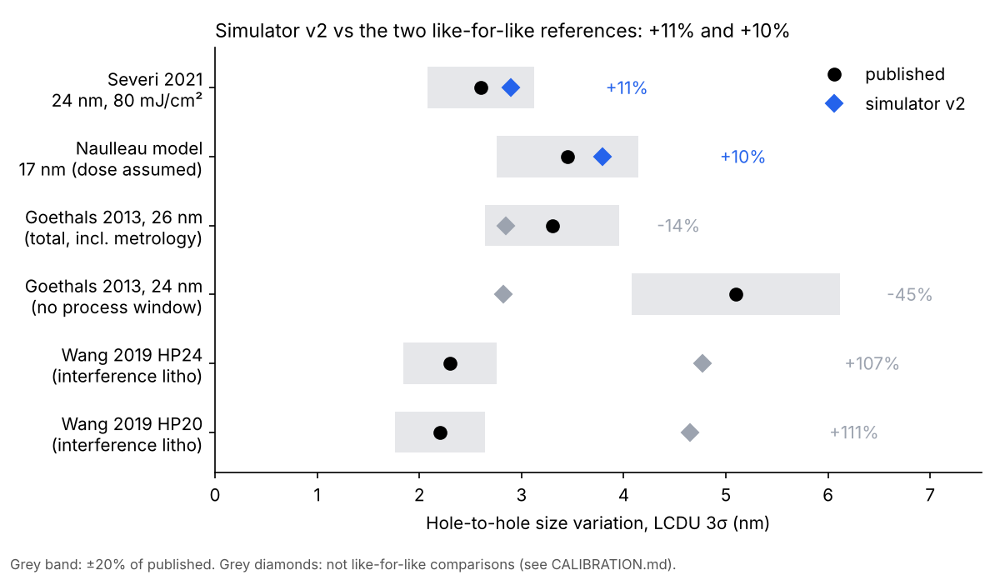
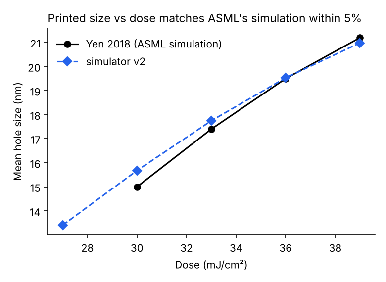
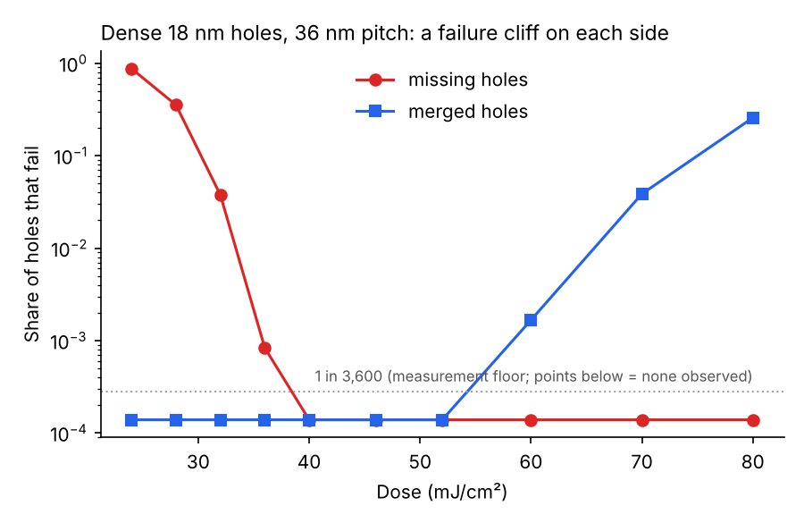

# Simulator v2 calibration report

*Generated Nov 2, 2026; corrected Nov 3 after source checks; numbers updated Nov 3 after the pass 2 cross-verification, which fixed the merged-hole flag and mask rounding (see [VERIFICATION.md](VERIFICATION.md)). The Severi row keeps pass 1's reading of the layout; VERIFICATION.md shows why that reading is uncertain. Reproduce with `python sim/calibrate.py` then `python sim/make_figures.py` (about 5 minutes). For the full source checks, extra real-world comparisons, convergence and sensitivity tests, see [VERIFICATION.md](VERIFICATION.md).*

## Verdict

Simulator v2 produces realistic numbers for a typical chemically amplified resist. Hole-to-hole size variation (LCDU) lands between −14% and +29% across eight comparisons with typical processes (measured data, industry data and two other models). The best modern resists do 30–50% better than the model (these are non-CAR resists, so not like-for-like; see VERIFICATION.md, Nov 25 correction). Printed size versus dose matches an ASML simulation within 5%, and every qualitative trend in the literature appears. The resist parameter that gets fitted (quencher loading) always lands inside its published range.

The weakest part is the **absolute rate of missing holes**. The failure cliffs have the right shape and roughly the right level (consistent with imec's report, via SemiWiki 2019, that the two failure cliffs touch around 1 ppm for a 40 nm pitch pattern), but rates are uncertain by about an order of magnitude. Treat them as estimates.

## What the model does

Each 1 nm × 1 nm pixel is a column through the resist film. Optionally, the film splits into depth layers (`layers=5`).

1. **Aerial image:** partially coherent imaging of a periodic hole array through an NA 0.33 lens at 13.5 nm (Abbe source-point sum, quasar or annular illumination), normalised to the open-frame dose.
2. **Photons:** absorbed photons per column are Poisson-distributed (dose × image × absorbed fraction).
3. **Electron blur:** Gaussian.
4. **Acid:** PAG molecules are Poisson-distributed. Conversion follows first-order kinetics, 1 − exp(−QE · photons / PAG), so acids per column are Poisson by thinning.
5. **Quencher:** Poisson-distributed per column.
6. **Bake:** acid and quencher diffuse (Gaussian) and neutralise. The net acid sets the protected fraction, m = exp(−K · h).
7. **Protecting groups:** Poisson-distributed; deprotected and remaining counts are drawn independently.
8. **Development:** a column dissolves when more than half its protecting groups are gone.

Every hole gets a printed size (equivalent-circle diameter of its largest connected dissolved region), a missing flag (that region is below 25% of the target area) and a merged flag (that region is shared with a neighbouring hole). Stray dissolved specks don't count.

### Parameters and where they come from

| Parameter | Default | Source |
| --- | --- | --- |
| Absorptivity | 4.2 /µm | Naulleau et al. (Berkeley MPPM model); Fallica 2015 measured 4.2–5.3 /µm for organic resists |
| Film thickness | 35 nm | Naulleau et al.; Fallica 2015 (25–45 nm) |
| Acids per absorbed photon (QE) | 2.8 | Naulleau & Gallatin, JM3 2018 (2.8); "Extreme stochastic events" (3) |
| PAG density | 0.20 /nm³ | Naulleau et al. (0.2); Naulleau & Gallatin, JM3 2018 (0.2) |
| Protecting groups | 2 /nm³ | Naulleau et al. |
| Electron blur σ | 1.7 nm | Electron range 4 nm (Naulleau, read as full width at half maximum); Bhattarai 2017: 1.8–2 nm |
| Acid diffusion σ | 5.0 nm | Acid range 10–12 nm (Naulleau, read as full width at half maximum); Gronheid 2011: ~4–5 nm |
| Quencher diffusion σ | 1.3 nm | Quencher range 3 nm (Naulleau, read as full width at half maximum) |
| Deprotection × bake, K | 60 nm³ | Naulleau & Gallatin, JM3 2018: deprotection rate 1 nm³/s, × an assumed 60 s bake (the paper gives no bake time) |
| Development threshold | 50% deprotected | Assumed (standard threshold model) |
| Quencher density | **fitted** per case | Must land in the published 0.012–0.09 /nm³ range (Naulleau & Gallatin 2018: 0.09; Naulleau et al.: 0.085; AIP Advances 2025: base 10–20% of PAG) |

The phrase "range" in Naulleau et al. is interpreted as full width at half maximum. That interpretation makes all three blur values agree with independent measurements.

## Results

### Hole-size variation (LCDU, 3σ)

| Reference | Conditions | Published | Simulator v2 | Difference | Like-for-like? |
| --- | --- | --- | --- | --- | --- |
| Severi et al. 2021 | 24 nm holes, staggered 80 × 46 nm pitch (rows reading), 80 mJ/cm², stochastic part only | 2.6 nm | 2.90 nm | +11% | Layout uncertain; see VERIFICATION.md |
| Naulleau et al. (model) | 16 nm half-pitch contacts, NA 0.33, their resist set; dose not stated, 82 mJ/cm² assumed | σ 1.15 nm | σ 1.26 nm | +10% | Yes (model vs model) |
| Goethals et al. 2013 | C31P52: 31 nm mask holes printing 26 nm, 52 nm pitch, NXE:3100 (NA 0.25), 60 nm film, 31.7 mJ/cm² | 3.3 nm | 2.85 nm | −14% | Partly: published total includes metrology and mask error. If ~80% is stochastic, as in Severi's breakdown, that's ~2.6 nm and +8%. |
| Goethals et al. 2013 | C29P48: 29 nm mask holes printing 24 nm, 48 nm pitch, 33.5 mJ/cm² | 5.1 nm | 2.82 nm | −45% | No: the paper reports no process window for this case, so focus and mask effects dominate |
| Wang et al. 2019 | HP24 at 16.4 mJ/cm²; HP20 at 21.1 mJ/cm² (best organic resist) | 2.3 / 2.2 nm | 4.77 / 4.65 nm | about +110% | No: interference lithography (double-exposure four-beam) forms a much higher-contrast image than a scanner, uses a ~25 nm film, and its dose is calibrated against a reference resist rather than measured |

### Printed size versus dose (Yen 2018, ASML stochastic simulation)

| Dose (mJ/cm²) | 30 | 33 | 36 | 39 |
| --- | --- | --- | --- | --- |
| Yen 2018 | 15.0 nm | 17.4 nm | 19.5 nm | 21.2 nm |
| Simulator v2 | 15.7 nm | 17.8 nm | 19.5 nm (sized here) | 21.0 nm |

Slope: 0.59 nm per mJ/cm² against a published 0.69 (−14%). Yen's pitch isn't stated, so the simulator uses 40 nm.

### Trends

| Trend | Literature | Simulator v2 |
| --- | --- | --- |
| Failures fall sharply as dose rises | imec 2018 | Yes |
| Dense arrays have two cliffs: missing holes at low dose, merged holes at high dose | imec (SemiWiki 2019) | Yes. For 18 nm holes at 36 nm pitch: 87% missing at 24 mJ/cm², none observed from 40 mJ/cm²; merging starts at ~60 and reaches 26% at 80 mJ/cm². |
| Variation scales with dose | 1/√dose for pure photon noise; flatter when resist noise matters (Mack 2019) | σ ∝ dose^−0.31 at 20–100 mJ/cm² (−0.41 if the resist is made slower through its deprotection rate instead of quencher) |
| Smaller holes vary more | Park et al. 2021 | Flat from 28 to 18 nm (2.8–2.9 nm), rising to 3.7 nm at 16 nm. This also matches IBM/Fractilia 2020, who saw no LCDU change with CD at larger sizes. |
| Fitted resist speed stays physical | Quencher 0.012–0.09 /nm³ | 0.012–0.086 /nm³ across all cases. At 100 mJ/cm² the fit gives 0.086, against Naulleau's 0.085. |

## Limitations

- **Missing-hole rates are the least constrained output.** Yen 2018 (an ASML simulation) reports ~10% closing near a 15 nm CD, where v2 gives ~1%, even though Yen's resist absorbs ~2.5× more photons (961 in a 27 nm cylinder vs 392 in v2). A 2017 PROLITH study also closes holes more abruptly as the mask shrinks. v2 may under-predict closing at small sizes by up to ~10×. Adding five depth layers (`layers=5`) changed LCDU by only 5% and did not raise closing rates.
- 2D column model by default. The 3D layered option exists but runs 4–5× slower.
- No mask 3D effects, flare, defocus or aberrations. A binary dark-field mask is assumed (mask size can differ from the target, with exact sub-pixel area). Illumination: quasar, hexapole, annular.
- Development is a simple threshold, not a full development-rate model.
- The simulator can't see rates below 1 in (number of holes simulated). Rare-event rates come from the surrogate models and long check runs.

## Runtime

On one CPU core: about 2,000 holes per setting in 1.2–2.2 s (4× longer with five layers). A 10,000-setting dataset takes about 3–6 hours on one core and well under an hour across 8 cores.

## Sources

- Severi, Lorusso, De Simone, Mack 2021, *Measuring and analyzing contact hole variations in EUV lithography*, Proc. SPIE 11609
- Naulleau, Bhattarai, Neureuther, *Understanding Extreme Stochastic Events in EUV Resists* (escholarship.org, qt3qr9g2g7)
- Naulleau & Gallatin 2018, *Relative importance of various stochastic terms and EUV patterning*, JM3 17(4) 041015
- Goethals et al. 2013, *EUV resist evaluation and process optimization towards NXE:3300*, EUVL Symposium
- Wang et al. 2019, *Progress in EUV resists for contact holes printing using EUV interference lithography*, Proc. SPIE 11177
- Yen 2018, EUVL Workshop slides (euvlitho.com/2018/P3.pdf)
- Mack 2019, *Metrics for stochastic scaling in EUV lithography*, Proc. SPIE
- (Nov 26: an earlier version also cited "Mack 2011, *EUV stochastic quenching kinetics*". No publication with that title could be found, so it was removed; the PAG and quencher values it was cited for are covered by Naulleau & Gallatin 2018 and the AIP Advances paper.)
- Fallica et al. 2015, EUV absorption coefficients of resists (EUVL Symposium poster)
- Bhattarai 2017, UC Berkeley thesis EECS-2017-125; Gronheid et al. 2011, JM3 10(3) 033004
- *Impact of chemical stochastics in EUV photoresists on the pattern quality*, AIP Advances 15, 035236 (2025)
- imec 2018 magazine article on EUV single exposure; SemiWiki 2019 summary of imec stochastic cliffs
- Park et al. 2021, J. Mater. Chem. C 9, 8189
