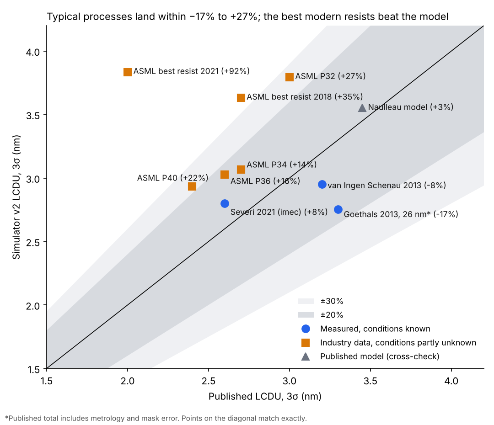

# Simulator v2 verification

*Nov 3, 2026, two independent passes. Every number is reproducible from `sim/`: `python calibrate.py`, `python verify.py`, `python extra_checks.py`, `python window_check.py 1`, `python analytic_check.py` (plus `python analytic_check.py linearity`), `python pass2_checks.py P1 P1b P1c P2 P2b P3 P4 P5 P6`, `python compare_passes.py`, then `python make_figures.py` and `python make_verification_figure.py`. Pass 1 outputs are kept in `results/pass1/`.*

## Bottom line (after both passes)

- **Hole-size variation (LCDU) for typical chemically amplified resists (CAR) is within about ±30%.** The eight comparisons with typical processes land at −14% to +29% (pass 1: −17% to +27%). Six of the eight are within ±20%. One of the eight is new in pass 2: a published result from PROLITH, a different stochastic simulator, which v2 matches within +2%.
- **The Monte Carlo itself is right.** A separate calculation that uses no random numbers (linear noise propagation) predicts the same photon and acid noise within 1–3% in all five test cases. The only gap (quencher noise, 9–12%) is explained and goes away where the theory is valid.
- **Pass 2 found two bugs and fixed them, plus one source detail pass 1 got wrong.** The merged-hole flag counted stray specks as merges, and mask holes were rounded to whole pixel pairs. Pass 1's best anchor, "within 8% of Severi 2021", is **withdrawn**: the paper's array layout can be read two ways, and the match ranges from −23% to +7% depending on the reading and illumination. Under the hexagonal reading, the tightest Severi array is missed badly (+43% to +113%).
- **Failure rates are right in order of magnitude but probably optimistic on missing holes.** At 40 nm pitch the two failure cliffs meet around 10⁻⁶ at typical doses, consistent with imec. Two other simulators (ASML's and PROLITH) close holes more readily near the small-size cliff, so v2 may under-predict missing holes by up to ~10×. Pass 1's merged-hole numbers were inflated 5–8× by the bug.
- **ASML's best resists (2018 / 2021) still beat the model by 46–110%, but they are not like-for-like.** The source slides list both as **non-CAR** resists printing P40 hexagonal pillars/contact holes (see the Nov 25 correction below), while v2 models a chemically amplified resist. Pass 2 tried the illumination those processes use (hexapole); it did not close the gap, which fits a resist-chemistry difference rather than optics.

- **Final checks before the dataset (Nov 4)** passed: optics confirmed a second way (within 0.35%), pixel, tile and fit convergence at the corners of the dataset domain, honest error bars, binomial failure counts (merges counted as events). See [DATASET.md](DATASET.md).

### Correction (Nov 25, 2026)

Re-checking the sources against the report found two errors in this file and its figure. Neither changes any simulator number.

| What was wrong | What the source shows | Fixed in |
| --- | --- | --- |
| The ASML 2018 / 2021 P40 points (2.7 / 2.0 nm) were listed as "P40 CAR LCDU" and called the best CAR resists | The ASML slide (van Schoot, EUVL Workshop 2021, slide 28) and the underlying imec/ASML talk (Santaclara et al., EUVL Workshop 2021, P51, slide 7) label the 2018 and 2021 entries **non-CAR**, for **P40 hexagonal pillars/CH**. The 2020 entry (2.1 nm) is the CAR one. The slide text is partly garbled, so this is the best reading; the Nov 10 audit reached the same conclusion for 2021. | Bottom line, pass 2 table, "ASML best resists" paragraph, source checks below, parity figure labels, pass 1 table |
| Parity figure headline said "−14% to +31%" | The plotted points give −14% to +29% (ASML P32 is the maximum), matching every table here. The headline was typed in by hand. | `make_verification_figure.py` now computes the headline from the data |

**Safe description for the project:** "a literature-parameterized stochastic simulator that reproduces published hole-size variation for typical CAR processes within about ±30%, cross-checked against an independent semi-analytical model and a published commercial-simulator result, with order-of-magnitude (likely optimistic) failure-rate estimates." It should not be described as matching any specific fab or resist.

## Cross-verification (pass 2)

### What pass 2 did differently

1. **A fresh code review**, including an independent re-implementation of hole measurement (connected-region labelling on a 3 × 3 copy of the periodic tile).
2. **An independent method:** a semi-analytical noise model (the linear-response idea behind Gaussian-random-field stochastic models) that predicts each noise source's hole-size variation without random numbers.
3. **New external data:** the full tables of Severi et al. 2021 (three pitches, two measurement runs), a 2017 PROLITH simulation study (*Line-edge roughness performance targets for EUV lithography*, co-authored by Chris Mack), the Goethals 2013 four-resist dose series, the dose-scaling study of Maas et al. 2018 (ASML), and the Church et al. 2020 IBM/Fractilia paper.
4. **Fresh random seeds and 2.5× more holes** (13,500+ per point) on every key comparison.

### Problems pass 2 found

| # | Problem | How it showed up | Fix | Effect |
| --- | --- | --- | --- | --- |
| 1 | **Merged-hole flag (bug).** Any two dissolved pixels touching across a cell border counted as merging the two holes, including stray specks between holes. | At 1.6× the sizing dose, 80 holes flagged merged vs 2 truly connected. At nominal dose it flagged 3% of holes in the Naulleau 32 nm-pitch case, 26% at ASML P30 and 44–54% in the interference-lithography case. Those holes were then dropped from LCDU. | A hole is now its largest connected dissolved region (periodic, edge-connected). It is merged only if that region is also another hole's region. Checked against the independent labelling: 100% agreement on 5,400 holes at three doses. New unit test. | LCDU +2–5% at nominal. Up to +18–32% where the bug had dropped many holes (P30, interference lithography). Merged rates fall 5–8×, and missing rates near the cliff rise 2–3× (fragments no longer count). |
| 2 | **Mask rounding (bug).** Mask holes were rounded to whole pixel pairs: 31 → 32 nm, 29 → 30, 17.17 → 18, 17 → 18, 19.5 → 20; a 22 and a 22.5 nm mask printed identically. | Found when a mask-size sweep gave repeated values | Each pixel now carries its exact covered fraction (anti-aliasing). Mask areas are exact. New unit test. | ≤ 3% on fitted comparisons (the resist re-fit absorbs most of it). Mask-size sweeps now work. |
| 3 | **Severi layout reading.** Pass 1 read "H80V46" as rows 46 nm apart. All three pitch pairs (80/46, 70/40, 66/38) have the ratio √3, which is the signature of a hexagonal array with 46 / 40 / 38 nm hole spacing. A 2023 Fractilia paper on the same imec layout describes it as hexagonal. The paper itself never says, and its "diagonal pitches of 46–56 nm" fits neither reading exactly. | Re-reading the full paper | Both readings are now simulated. The paper's stated 50 nm film and custom hexapole illumination are used (pass 1 used 35 nm and annular). A hexapole option was added. | See "New measured data" below |
| 4 | Output paths were relative to wherever the script was launched, so `calibrate.py` crashed when run from `sim/` | Running it | Paths are now relative to the script file | None on results |

Also noted: in the high-quencher Naulleau case the deprotection-rate fit is poorly conditioned (values from 67 to 329 nm³ print the same size). LCDU changes by under 2% across them, so the result stands.

### Where pass 1 and pass 2 agree and disagree

| Claim | Pass 1 | Pass 2 | Verdict |
| --- | --- | --- | --- |
| LCDU band, typical processes (8 comparisons) | −17% to +27% | −14% to +29% (fresh seeds, 13,500+ holes) | **Agree.** Shifted up ~3% by the hole-measurement fix |
| Severi 2021 match | +8% | −13% to +7% (rows reading), −23% or −7% (hexagonal, hexapole or annular) | **Disagree.** Pass 1 was over-confident; the layout is ambiguous |
| Naulleau model | +3% | +9% | Agree within the band |
| Another simulator (PROLITH, 2017 study) | not checked | +2% (one layer), +8% (five layers) | New agreement |
| Best modern resists (ASML 2018 / 2021; non-CAR per the slides) | +35% / +92% | +46% / +110% with hexapole (+40% / +102% annular) | Agree, but not like-for-like: a non-CAR process against a CAR model |
| ASML P30 | +52%, "past the model's limit (26% merged)" | +79%, only 1.2% merged | Number agrees in direction; **pass 1's explanation was the bug** |
| Interference lithography (Wang 2019) | not comparable, "most holes merged" | not comparable, 3× too high, few merges | Same conclusion; pass 1's explanation was the bug |
| Severi sensitivity range | 2.64–3.20 nm | 2.67–3.32 nm | Agree |
| Pixel size 0.5 vs 1 nm (re-fitted) | −5% | −2% | Agree |
| Dose scaling exponent | −0.29 | −0.31 | Agree |
| Merged holes appear at | 120–160% of sizing dose | 160–180% | **Pass 1 wrong** (bug) |
| P40 failure valley | "meet around 10⁻⁵–10⁻⁶" | 4 × 10⁻⁶ (30 mJ/cm²), 2 × 10⁻⁶ (50), 3 × 10⁻⁸ (80) | Agree in order of magnitude; pass 1's merged-side fit wasn't valid |
| Missing holes vs other simulators | ~10× fewer than ASML (Yen) | ~9× fewer than Yen; PROLITH's cliff is steeper and earlier | Agree, now with two independent simulators |
| Photons absorbed vs Yen's resist | Yen ~2.2× more | ~2.5× more (exact mask size) | Agree |

### Independent check 1: semi-analytical noise model

The printed area of a hole changes by an amount that, to first order, is a weighted sum of the random net-acid field along the mean resist contour. For each Poisson noise source (photons, acid generation, quencher, protecting groups), the variance of that sum can be computed exactly from the mean fields and the blur kernels, with no random numbers (Campbell's theorem). The Monte Carlo was then run with one noise source switched on at a time.

| Case | Photons: MC / theory | Acid: MC / theory | Quencher: MC / theory | Protecting groups: MC / theory | All: MC / theory |
| --- | --- | --- | --- | --- | --- |
| P40, 20 nm, 30 mJ/cm² | 1.01 | 0.99 | 0.91 | 1.08 | 0.97 |
| Severi (rows reading), 80 mJ/cm² | 1.01 | 1.01 | 0.90 | 1.03 | 0.96 |
| P40, 20 nm, 21 mJ/cm² | 0.99 | 1.02 | 0.88 | 1.11 | 0.99 |
| Goethals, NA 0.25, 60 nm film | 0.99 | 1.02 | 0.91 | 1.00 | 0.94 |
| Naulleau, P32 | 1.01 | 1.02 | 0.90 | 0.99 | 0.96 |

**Reading this:** photon and acid noise agree within 1–3% everywhere, which checks the whole photon → electron blur → acid → diffusion chain. Quencher noise in the Monte Carlo is 9–12% below the theory. The cause is that the quencher barely diffuses (1.3 nm), and noise that short-ranged is outside the linear theory's validity. Proof: with quencher blur of 2.5 or 4 nm the two agree within 1%, and halving the pixel size doesn't change the gap (`analytic_linearity.json`). The theory also gives a noise budget: in this resist, **quencher noise is the largest single source**, then photons, then acid; protecting groups are minor.

### Independent check 2: another simulator (PROLITH)

The 2017 SPIE paper *Line-edge roughness performance targets for EUV lithography* (co-authored by Chris Mack, Fractilia) ran PROLITH's stochastic model for dense holes on 50 nm centres: mask 24 nm printing 23 nm at 72 mJ/cm², 0.33 NA, small annular illumination (σ 0.292–0.643), 30 nm CAR, 5,000 holes. PROLITH's resist parameters were tuned to experiments but not published.

| | PROLITH | v2 (one layer) | v2 (five layers) |
| --- | --- | --- | --- |
| LCDU at mask 24 nm | 3.12 nm | 3.19 nm (+2%) | 3.36 nm (+8%) |
| Missing holes | none at mask ≥ 23.5 nm; rising fast below; a spike of fully closed holes at 22.0–22.5 nm | none at 22.5 nm and above; 0.11% at 22.0 nm (0.15% with five layers) | |
| Mask error factor | > 10 below 23 nm | 2.5–2.9 | 2.4–2.8 |

At nominal conditions v2 and PROLITH agree. Near the small-size cliff, PROLITH's holes shrink and close much more abruptly. That is the same direction as the ASML comparison (Yen 2018), so two independent simulators now say v2 is optimistic about missing holes. The likely reason is v2's simple threshold development, against PROLITH's full development-rate model. Adding depth layers does not change this.

### New measured data

**Severi et al. 2021, all three pitches** (stochastic-only LCDU, two runs each; 24 nm holes, 80 mJ/cm², NXE:3400, custom hexapole, 50 nm film). The paper gives 24 nm only for H80V46; the other two are assumed to be 24 nm too.

| Array | Measured | Rows reading, hexapole | Rows reading, annular | Hexagonal, hexapole | Hexagonal, annular |
| --- | --- | --- | --- | --- | --- |
| H80V46 | 2.64 / 2.80 | 2.38 (−13%) | 2.46 (−10%) | 2.09 (−23%) | 2.52 (−7%) |
| H70V40 | 2.29 / 2.48 | 2.18 (−9%) | 2.47 (+4%) | 3.03 (+27%) | 2.95 (+24%) |
| H66V38 | 2.35 / 2.55 | 2.20 (−10%) | 2.55 (+4%) | 5.21 (+113%, 10% merged) | 3.50 (+43%) |

Under the rows reading, v2 matches all three within −13% to +4% and reproduces the measured flat trend with pitch. Under the hexagonal reading, v2 predicts variation climbing steeply as the spacing tightens, which the data doesn't show. Shrinking the holes with the spacing (21.0 and 19.8 nm) doesn't fix it (3.19 and 5.07 nm). Either the rows reading is right, or v2 is too pessimistic for very tight hexagonal arrays. The real process could also have used mask or source optimizations v2 lacks. The geometry question can't be settled from the paper, so Severi is no longer used as the headline anchor.

**Goethals 2013, four resists at the same 26 nm holes** (NXE:3100, NA 0.25, 60 nm film; 1σ totals including mask and metrology; the slide's column labels are garbled, the dose–LCDU pairs are as printed):

| Dose-to-size (mJ/cm²) | 18.1 | 19.4 | 26.3 | 31.7 |
| --- | --- | --- | --- | --- |
| Measured 1σ (total) | 1.5 nm | 1.2 nm | 1.1 nm | 1.1 nm |
| v2 1σ (stochastic only) | 1.12 (−25%) | 1.10 (−8%) | 1.01 (−8%) | 0.94 (−15%) |

v2 sits below the totals, as it should, since the totals also contain mask and metrology error. Its dose trend is weaker than the data (1.19× from 31.7 to 18.1 mJ/cm² against 1.36×), but these are four different resists, not one resist at four doses.

**ASML best resists with hexapole illumination:** 3.95 / 4.21 nm against 2.7 / 2.0 nm (+46% / +110%). Hexapole didn't help, so the gap to the best resists is resist chemistry, not illumination. That fits the sources: both entries are non-CAR resists (see the Nov 25 correction), a chemistry v2 does not model.

**Church et al. 2020 (IBM/Fractilia)** contributes two checks without new numbers to fit: SEM noise inflated their measured via LCDU by about 0.6 nm, which is why every comparison here uses stochastic-only or low-noise values where available; and their unbiased LCDU didn't change with CD, matching v2's flat size trend from 18 to 28 nm.

### Dose scaling: how the resist is changed matters

Maas et al. 2018 (ASML), using a metal-oxide resist model, found LCDU scaling as dose^−0.5 when a resist is made slower by changing its development threshold, but dose^−0.33 when its quantum efficiency changes. In v2, making the resist slower with quencher gives dose^−0.30, and with a threshold-like knob (the deprotection rate) gives dose^−0.41. Same ordering, same ballpark. When the ML dataset varies dose, the dose trend it learns depends on which resist knob is varied alongside, and that should be stated.

### Failure rates revisited (40 nm pitch, 20 nm holes, 13,500 holes per point)

The cliff tails (rates of 10⁻⁴ to 0.2) were fitted as straight lines in log-rate versus dose and extended to where they cross. That extrapolation covers 2–3 orders of magnitude, so treat it as an estimate.

| Resist sized at | Missing below 10⁻⁶ above | Merged below 10⁻⁶ below | Cliffs cross at | Rate at the crossing |
| --- | --- | --- | --- | --- |
| 30 mJ/cm² | 33.8 mJ/cm² | 28.3 mJ/cm² | 32.4 mJ/cm² | 4 × 10⁻⁶ |
| 50 mJ/cm² | 51.1 | 48.2 | 50.5 | 2 × 10⁻⁶ |
| 80 mJ/cm² | 77.2 | 104.7 | 83.1 | 3 × 10⁻⁸ |

A window with both rates below 10⁻⁶ opens for resists sized at roughly 55 mJ/cm² and above. ASML's simulation needs 79 mJ/cm² for the same goal, and imec reported the two failure cliffs touching around 1 ppm for a 40 nm pitch pattern (SemiWiki's summary does not say whether the pattern was holes or lines). So v2 has the right order of magnitude but leans optimistic, consistent with the missing-hole comparisons above. Merging now needs a real bridge, so it starts at 160–180% of the sizing dose.

### Fresh seeds, larger samples

| Comparison | Calibration run | Fresh seeds, 13,500+ holes | Published |
| --- | --- | --- | --- |
| van Ingen Schenau 2013 | 3.03 | 3.03 | 3.2 |
| Goethals 2013, 26 nm | 2.85 | 2.83 | 3.3 (total) |
| ASML P40 / P36 / P34 / P32 | 3.01 / 3.14 / 3.23 / 3.92 | 3.01 / 3.08 / 3.17 / 3.88 | 2.4 / 2.6 / 2.7 / 3.0 |
| Naulleau model | 3.79 | 3.75 | 3.45 |

Every number reproduces within 2%, so the comparisons are not luck of the draw.

### Sources added in pass 2

| Source | What was used | How verified |
| --- | --- | --- |
| Severi, Lorusso, De Simone, Mack 2021, Proc. SPIE 11609, 1160913 | Tables I, III, IV: stochastic LCDU at three pitches, two runs; 80 mJ/cm², NXE:3400, custom hexapole, 50 nm CAR | Full PDF (Fractilia) |
| Fractilia, EUVL 2023, *Hole LCDU* | The same imec layout described as hexagonal: 40 nm centre-to-centre, 40 × 70 nm unit cell, 24 nm holes | Search excerpt (full PDF not reachable) |
| *Line-edge roughness performance targets for EUV lithography*, Proc. SPIE 2017 (co-author C. Mack) | PROLITH: dense holes on 50 nm centres, mask 24 → 23 nm, 72 mJ/cm², small annular, LCDU 3.12 nm, failure and MEEF behaviour | Full PDF (lithoguru.com) |
| Goethals et al. 2013, EUVL Symposium | Four resists at C31P52: 18.1 / 19.4 / 26.3 / 31.7 mJ/cm² with 1σ 1.5 / 1.2 / 1.1 / 1.1 nm | Full slides; column labels garbled |
| Maas et al. 2018, JM3 17(4) 041003 (ASML) | LCDU ∝ dose^−0.5 (threshold changes) vs dose^−0.33 (QE changes), metal-oxide model | Abstract |
| Church et al. 2020, JM3 19(3) 034001 (IBM) | SEM noise inflated via LCDU by 0.6 nm; unbiased LCDU flat with CD | Abstract |
| De Bisschop & Hansen 2022, JM3 21(3) 033201; Hansen 2018 | LCDU ∝ 1/ILS correlator; Gaussian-random-field models (method behind check 1) | Abstracts |
| van Schoot (ASML), *High-NA EUV progress and outlook*, EUVL Workshop 2021 (euvlitho.com/2021/P3.pdf) | P40 dense holes need 79 mJ/cm² for < 10⁻⁶ defects at 0.33 NA (simulated, photon noise only) | Slides (also used in pass 1) |
| Santaclara et al. (ASML/imec), *Progress and outlook towards High-NA EUV resist*, EUVL Workshop 2021 (euvlitho.com/2021/P51.pdf) | Resist type for each P40 hexagonal pillars/CH entry (added Nov 25) | Slides |

### What pass 2 means for the project

- Generate the ML dataset with the fixed simulator. The merged-hole fix changes the failure labels the models will learn.
- Present LCDU as "within about ±30% of published typical processes" and failure rates as "order-of-magnitude, probably optimistic on missing holes".
- If time allows, a full development-rate model is the most valuable upgrade: it is the most likely cause of the missing-hole gap.

## Pass 1 details (Nov 3, before the pass 2 fixes)

*Kept for the record. Where a number below differs from pass 2, pass 2 is current.*

### Corrections to the Nov 2 calibration

| Item | What the Nov 2 report said | What checking the source showed | Effect |
| --- | --- | --- | --- |
| Goethals 2013 | 31 nm and 29 nm holes | C31P52 / C29P48 are 31 / 29 nm **mask** holes printing **26 / 24 nm** | Re-run: 2.75 nm against 3.3 nm measured total (−17%) |
| Naulleau model cross-check | At ~82 mJ/cm² | The paper doesn't state the dose for that result; 82 comes from a different section | Comparison kept, labeled as an assumed dose |
| Yen 2018 (ASML) | Called "data" | ASML stochastic **simulations** (10,000 holes per dose); pitch, film and resist not stated | Relabeled as a simulation |
| Yen 2018 photon count | His holes absorb ~5× more photons | Misread. Columns are most likely cylinder diameters: 961 photons in 27 nm vs 420 in v2 | **About 2.2×**, not 5× |
| Wang 2019 (interference lithography) | Peak intensity ~4× the stated dose | That was my reasoning, not the paper's. PSI uses double-exposure four-beam interference, ~25 nm film, and a dose calibrated against a reference resist | Still not like-for-like, for the stated reasons. My attempt to simulate an interference image merged most holes, so it is not informative. |

### Source checks

| Claim used | Source | How verified | Status |
| --- | --- | --- | --- |
| 24 nm holes, staggered 80 × 46 nm, 80 mJ/cm², after develop, stochastic LCDU 2.6 nm | Severi et al. 2021 | Abstract + authors' PDF (via search) | Confirmed |
| CAR parameter set (QE 3, PAG 0.2, quencher 0.085, protecting groups 2 /nm³, 4.2 /µm, 35 nm, ranges 12/4/3 nm, threshold development) | Naulleau, Bhattarai, Neureuther | Full text read | Confirmed; "range" undefined in the paper |
| CD 15 / 17.4 / 19.5 / 21.2 nm at 30 / 33 / 36 / 39 mJ/cm²; ~10% closing at 15 nm | Yen 2018 slides | Full slides read | Confirmed; simulations |
| Dose-to-size 31.7 / 33.5 mJ/cm², 1σ LCDU 1.1 / 1.7 nm, NA 0.25, 60 nm film, quasar | Goethals et al. 2013 | Full slides read | Confirmed; corrected CDs |
| 0.33 NA, 40 nm CAR: LCDU 2.4 / 2.6 / 2.7 / 3.0 / 3.6 nm at P40–P30, 63–73 mJ/cm² | ASML 2024 investor presentation (SEC exhibit 99.4) | Full text read | Confirmed numbers; measured vs simulated and pattern type not stated |
| P40 hexagonal pillars/CH LCDU 2.7 / 2.2 / 2.1 / 2.0 nm at 66 / 65 / 61 / 53 mJ/cm² (2018–2021) | ASML (van Schoot), EUVL Workshop 2021; Santaclara et al., EUVL Workshop 2021 | Slides read | Confirmed numbers. **Corrected Nov 25:** originally listed as CAR; the slides label 2018, 2019 and 2021 non-CAR and 2020 CAR |
| P40 dense holes at 0.33 NA need 79 mJ/cm² for <10⁻⁶ defect rate | ASML, EUVL Workshop 2021 | Slides read | Confirmed; simulated |
| 24 nm HP regular holes: LCDU 3.2 nm (small annular, 31 mJ/cm² resist) | van Ingen Schenau 2013 (ASML) | Slides via search | Confirmed numbers; sigma values assumed |
| Cliffs "touch at around 1 ppm" at 40 nm pitch | imec via SemiWiki 2019 | Article text | Confirmed (dose and feature type not stated) |
| Absorptivity 4.2–5.3 /µm (CAR), 15–19 /µm (metal oxide); films 25–45 nm | Fallica 2015 | Full poster read | Confirmed |
| ~2 acids per absorbed photon; electron blur 1.8–2 nm | Bhattarai 2017 | Full text read | Confirmed |
| Total blur ~4 nm at lowest bake; acid diffusion target ~5 nm | Gronheid 2011 | Abstract | Confirmed |
| PAG 0.04–0.2 /nm³; base 10–20% of PAG | AIP Advances 2025 | Abstract | Confirmed |
| Quencher/PAG 0.4 in a generic CAR | Contribution of EUV resist counting statistics (JMM 2021) | Abstract | Confirmed |
| 92 eV photons; 0.680 photons/nm² per mJ/cm² | Physics (E = hc/λ) | Computed; unit test | Confirmed |

### Real-world LCDU comparisons (pass 1 numbers)

| Reference | Type | Published | v2 | Difference |
| --- | --- | --- | --- | --- |
| Severi 2021, 24 nm holes, 80 mJ/cm² | Measured, stochastic only | 2.6 nm | 2.80 nm | +8% |
| van Ingen Schenau 2013, 24 nm HP, 31 mJ/cm² resist | Measured | 3.2 nm | 2.95 nm | −8% |
| Goethals 2013, 26 nm holes, NA 0.25 | Measured total | 3.3 nm | 2.75 nm | −17% (about +6% if ~80% of the total is stochastic, as in Severi) |
| ASML 2024, P40 / P36 / P34 / P32 | Industry, conditions partly unknown | 2.4 / 2.6 / 2.7 / 3.0 nm | 2.93 / 3.03 / 3.07 / 3.80 nm | +22% / +16% / +14% / +27% |
| ASML 2024, P30 | Industry, near resolution limit | 3.6 nm | 5.48 nm | +52%; v2's square-array setup is past its limit (26% merged) |
| ASML best resists 2018 / 2021, P40 | Industry; non-CAR per the slides; hexagonal pattern approximated | 2.7 / 2.0 nm | 3.63 / 3.83 nm | +35% / +92% |
| Naulleau model, 16 nm HP | Published model | 3.45 nm | 3.55 nm | +3% |
| Goethals 2013, 24 nm (no process window) | Measured total | 5.1 nm | 2.76 nm | Not comparable |
| Wang 2019 (interference lithography) | Measured, different tool | 2.2–2.3 nm | 4.5 nm | Not comparable |

**Reading this table:** the model is most accurate for typical processes and is conservative (noisier) than the best recent resists and optimized illumination. The ASML "best resist" points also used an approximate hexagonal geometry with plain annular illumination, which handicaps the model.

### Numerical checks

| Check | Result |
| --- | --- |
| Pixel size 0.5 nm vs 1 nm | LCDU 3.76–3.89 vs 3.94 nm (1–5% lower); 1 nm is adequate |
| Light-source sampling 11 vs 7 points per pole | Identical, as expected: for an in-focus periodic pattern only which diffraction orders pass matters |
| Tile 5 × 5 vs 3 × 3 holes | 3.93 vs 3.94 nm |
| Repeat with three random seeds | 3.82 / 3.90 / 3.98 nm (±2%) |
| 8 unit tests | All pass |

### Sensitivity of the Severi match

Each uncertain parameter was moved across its published range, with the resist re-fitted every time. The match stays between **2.64 and 3.20 nm** against 2.6 published.

| Change | LCDU (nm) |
| --- | --- |
| Baseline | 2.82 |
| Acid blur 4.0 / 6.0 nm | 2.68 / 2.92 |
| Electron blur 1.2 / 2.5 nm | 2.74 / 2.88 |
| Acids per photon 2.0 / 3.5 | 2.86 / 2.76 |
| PAG 0.12 / 0.30 /nm³ | 3.20 / 2.64 |
| Protecting groups 1.5 / 3.0 /nm³ | 2.81 / 2.79 |
| Development threshold 0.3 / 0.7 | 2.85 / 2.78 |
| Absorptivity 5.3 /µm | 2.70 |
| Film 30 nm | 3.00 |
| Annular 0.3–0.7 | 2.72 |
| Five depth layers | 2.96 |

### Failure-rate checks (pass 1; superseded by pass 2)

- **Dose windows at 40 nm pitch** (resist sized for 20 nm holes at 30, 50 and 80 mJ/cm²; 13,500 holes per point). Missing holes fall from ~1–5% at 75% of the sizing dose to ~10⁻³–10⁻⁴ at 85%. Merged holes appear at 120–160% of the sizing dose. Extending both cliffs, they meet around 10⁻⁵–10⁻⁶. That matches imec's measured "cliffs touch at around 1 ppm" at 40 nm pitch, and is consistent with ASML's simulation that a <10⁻⁶ window needs high dose (79 mJ/cm²). The windows widen as the sizing dose rises, as ASML reports.
- **At nominal dose,** 108,000 holes at 30 mJ/cm² gave zero failures, so the rate there is below 3 × 10⁻⁵ (rule of three).
- **Against Yen 2018 (ASML simulation),** v2 closes about 1% of holes at a 15 nm mean CD; ASML reports ~10%, with a resist absorbing ~2× more photons. Pitch and resist aren't stated, but this suggests v2 may under-predict closing at small sizes by up to ~10×.
- **Conclusion:** treat failure probabilities as order-of-magnitude estimates. Present the *shape* of the cliffs and how they move with dose, pitch and size as reliable trends, and absolute rates as uncertain within a factor of ~10.

### What would make it more realistic

Not needed for the project, but worth listing as future work:

- A full development-rate model and 3D dissolution paths (likely raises closing rates at small CD).
- Mask bias, attenuated phase-shift masks, and optimized pupils (hexapole, dipole), which would close part of the gap to the best modern processes.
- Calibration against a single resist's full dataset (dose, focus, CD, LCDU and defect counts together), which only a fab or resist supplier has.
